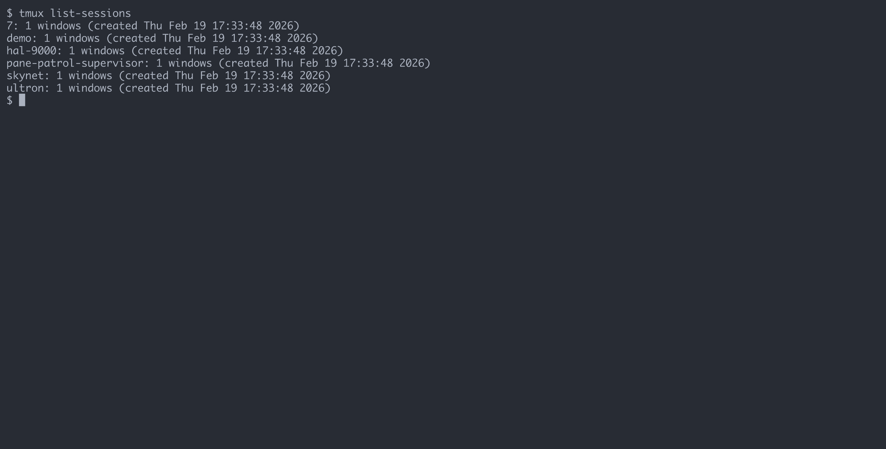

# tmux-assistant-resurrect

> **Disclaimer**: This project was entirely vibecoded (designed and implemented
> through conversation with AI coding assistants). It has been end-to-end tested
> in Docker with real CLI binaries (Claude/Copilot/OpenCode/Codex/Pi/Oh My Pi)
> (400+ automated tests + full save/kill/restore lifecycle smoke test).
> Cursor, Grok and Kiro CLI are supported with hermetic unit tests but have no
> authenticated Docker integration test.
> **Limited real-world usage** so far — expect
> rough edges. Contributions and bug reports welcome.

Persist and restore AI coding assistant sessions across tmux restarts and reboots.



When your computer shuts down, tmux sessions are lost -- including any running
[Claude Code](https://github.com/anthropics/claude-code),
[Cursor Agent CLI](https://cursor.com/docs/cli/overview),
[GitHub Copilot CLI](https://docs.github.com/copilot/how-tos/use-copilot-agents/use-copilot-cli),
[OpenCode](https://github.com/opencode-ai/opencode),
[Codex CLI](https://github.com/openai/codex),
[Pi](https://github.com/mariozechner/pi),
[Oh My Pi](https://github.com/can1357/oh-my-pi), Antigravity CLI (`agy`), or
[Grok Build](https://x.ai/cli) (xAI's `grok` CLI / TUI, not the community
`grok-cli`), or [Kiro CLI](https://kiro.dev/cli/) (`kiro-cli`) instances. This project hooks into
[tmux-resurrect](https://github.com/tmux-plugins/tmux-resurrect) to
automatically save assistant session IDs, CLI flags, and environment variables,
then re-launch them with the exact same configuration after a restore.

## How it works

```
SAVE (every 5 min + manual prefix+Ctrl-s)
  tmux-resurrect saves pane layouts
    -> post-save hook inspects child processes of each pane
    -> detects assistants by binary name (claude, agent/cursor-agent, copilot, opencode, codex, pi, omp, grok, agy, kiro-cli)
    -> extracts session IDs via native hooks/plugins/process args
    -> writes assistant-sessions.json in tmux-resurrect's save dir

RESTORE (on tmux start or manual prefix+Ctrl-r)
  tmux-resurrect restores pane layouts
    -> post-restore hook reads assistant-sessions.json
    -> reconstructs full CLI invocation with saved flags + env vars
    -> sends resume commands to each pane, e.g.:
         ANTHROPIC_BASE_URL='...' claude --dangerously-skip-permissions --resume <id>
         agent --mode plan --resume <session-id>
         copilot --allow-all --resume=<id>
         opencode --verbose -s <session-id>
         codex --full-auto resume <session-id>
         pi --model sonnet --session <session-id>
         omp --profile work --restore <session-id>
         grok --resume <session-id>
         kiro-cli chat --resume-id <session-id>
         agy --conversation <session-id>
```

Detection, session-ID lookup and resume commands for each assistant are
described in [Supported assistants](docs/assistants.md); the save/restore hooks
in [Architecture](docs/architecture.md).

## Prerequisites

- [tmux](https://github.com/tmux/tmux) (tested with 3.4 through 3.7)
- [TPM](https://github.com/tmux-plugins/tpm) (Tmux Plugin Manager)
- [jq](https://jqlang.github.io/jq/) (used by save/restore scripts)

No assistant is required: the plugin is safe to install on its own and simply
has nothing to resume until one of the supported assistants runs in a pane.

## Installation

Install [TPM](https://github.com/tmux-plugins/tpm) if you don't have it:

```bash
git clone https://github.com/tmux-plugins/tpm ~/.tmux/plugins/tpm
```

Add to your `~/.tmux.conf`:

```bash
set -g @plugin 'tmux-plugins/tpm'
set -g @plugin 'tmux-plugins/tmux-resurrect'
set -g @plugin 'tmux-plugins/tmux-continuum'
set -g @plugin 'timvw/tmux-assistant-resurrect'

# Optional: restore terminal text in non-assistant panes after tmux restart.
# If enabled, the plugin automatically strips captured content for assistant
# panes so restore won't briefly flash stale TUI output before resuming.
# set -g @resurrect-capture-pane-contents 'on'

# Initialize TPM (must be last line)
run '~/.tmux/plugins/tpm/tpm'
```

Then inside tmux, press `prefix + I` (capital I). TPM will clone the plugins
and automatically set up:

- tmux-resurrect + tmux-continuum settings
- Claude Code hooks in `~/.claude/settings.json`
- Cursor Agent CLI hooks in `~/.cursor/hooks.json`
- Copilot support via its per-session `inuse.<pid>.lock` file (no hook/plugin required)
- OpenCode session-tracker plugin in `~/.config/opencode/plugins/` (one for v1, one for v2)
- Pi support via session-file lookup in `~/.pi/agent/sessions` (no hook/plugin required)
- Oh My Pi support via terminal/session-file lookup in `$XDG_STATE_HOME/omp`, `$XDG_DATA_HOME/omp`, or `~/.omp` (no hook/plugin required)
- Grok support via the `~/.grok/active_sessions.json` registry (no hook/plugin required)
- Antigravity CLI support via the log file its process has open (no hook/plugin required)
- Kiro CLI support via its session lock files under `~/.kiro/sessions/` (`cli/<uuid>.lock` for the default TUI, `<workspace-hash>/sess_<uuid>/.lock` for `--v3`; no hook/plugin required)

Native hook/plugin installers are enabled by default and can be switched off
per assistant (`@assistant-resurrect-claude`, `-cursor`, `-opencode`). See
[Native hook/plugin installers](docs/configuration.md#native-hookplugin-installers)
for the options and how the OpenCode v1/v2 tracker is chosen.

## Uninstallation

**TPM users**: Remove the `@plugin 'timvw/tmux-assistant-resurrect'` line from
`~/.tmux.conf`, then press `prefix + alt + u` inside tmux.

**`just install` users**: Run `just uninstall` from the plugin directory — this
removes the Claude and Cursor hooks, the OpenCode plugin symlink, and the managed
block from `~/.tmux.conf`.

## Usage

### Automatic (recommended)

Once installed, everything runs automatically:

- **tmux-continuum** saves your tmux layout every 5 minutes
- **Post-save hook** collects assistant session IDs at each save
- **On tmux server start**, continuum auto-restores the layout
- **Post-restore hook** resumes each assistant with its saved session ID

The plugin defaults `@continuum-save-interval` to 5 and `@continuum-restore` to
`on`, but only when they are not already set — your own values in `~/.tmux.conf`
are never overwritten.

Manual save/restore keybindings (tmux-resurrect defaults):

| Key | Action |
|-----|--------|
| `prefix + Ctrl-s` | Save tmux state + assistant sessions |
| `prefix + Ctrl-r` | Restore tmux state + resume assistants |

Want to see the full save → kill → restore cycle on your own machine? Follow
the [step-by-step walkthrough](docs/walkthrough.md).

## Limitations

The main caveats (the [full list](docs/troubleshooting.md#limitations) covers
each assistant in detail):

- **Running state is not preserved**: assistants come back with their
  conversation history, but in-flight tool calls are lost.
- **Some sessions cannot be identified yet**: a Copilot session you have not
  typed into, Kiro's classic UI, and OpenCode without its plugin or `-s` when
  its database fallback finds nothing for the pane's directory come back as a
  plain shell.
- **Same-cwd ambiguity**: where an assistant falls back to a cwd-scoped lookup
  (OpenCode database, Pi session files, Claude transcripts), two sessions in the
  same directory can be mixed up.
- **Session-less modes need a voucher**: `claude agents` and similar are only
  relaunched after you explicitly vouch the exact command.
- **Undocumented upstream interfaces**: several assistants are tracked through
  lock files or logs that are not a public API, so an upstream release may need
  a fix here.

Something not restoring? See [Troubleshooting](docs/troubleshooting.md).

## Documentation

| Page | What's in it |
|------|--------------|
| [Configuration](docs/configuration.md) | Installer opt-outs, save location, state directory, env capture, state roots, secrets, replay exclusions, relaunch vouchers, PATH, pacing, watchdog |
| [Supported assistants](docs/assistants.md) | How each assistant's session ID is found and how it is resumed |
| [Walkthrough](docs/walkthrough.md) | Save → kill → restore on your own machine, with example output |
| [Troubleshooting and limitations](docs/troubleshooting.md) | Symptom/check table and the full list of known limitations |
| [Architecture](docs/architecture.md) | Save/restore flow, the hooks, repository layout |
| [Design principles](docs/design-principles.md) | Why detection and extraction work the way they do |
| [Testing](docs/testing.md) | Docker suites, hermetic suites, benchmarks |
| [AGENTS.md](AGENTS.md) | Conventions for contributors and coding agents, including adding a new assistant |

## License

MIT
